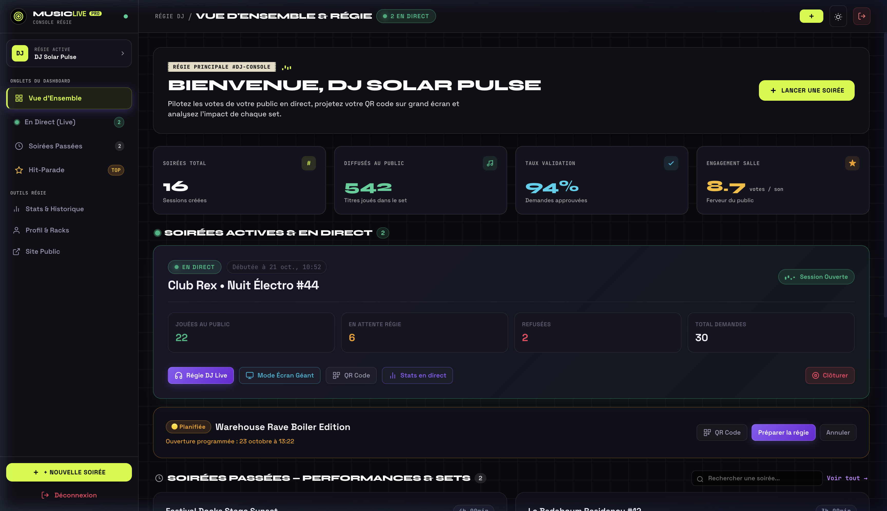
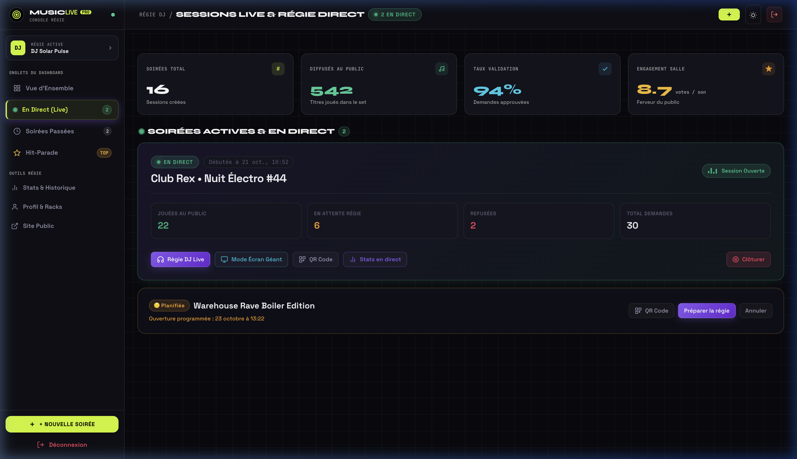
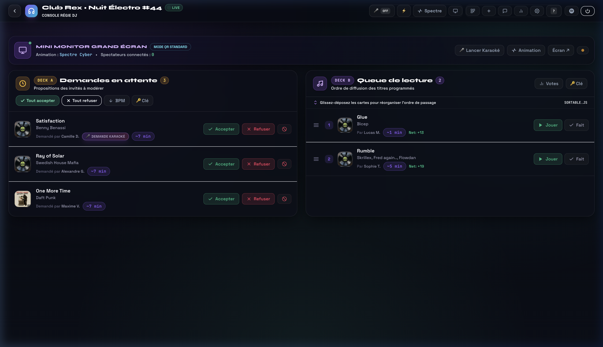
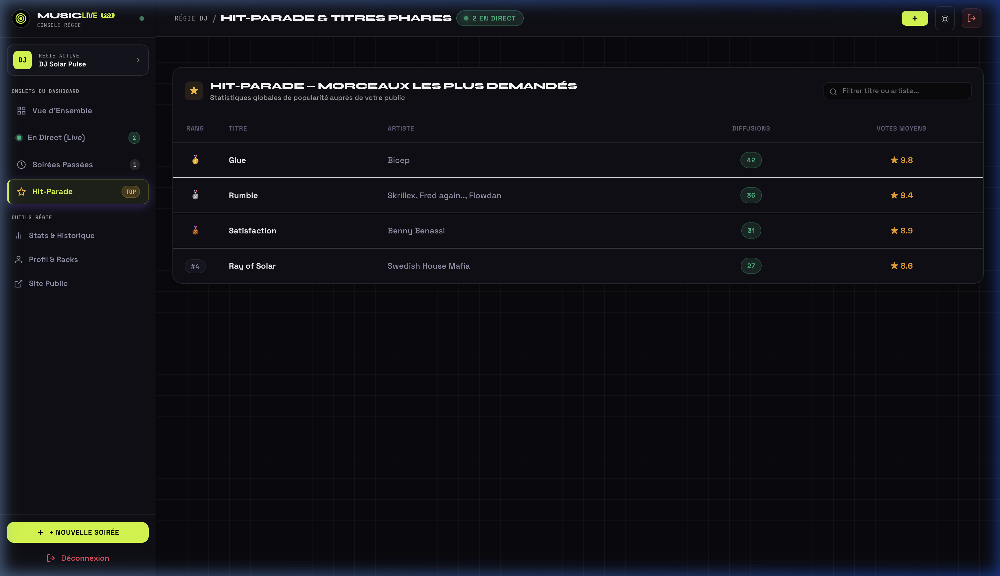
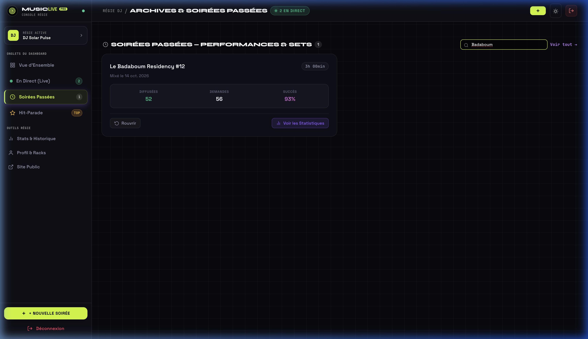
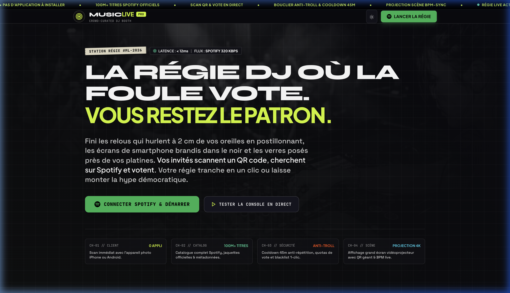
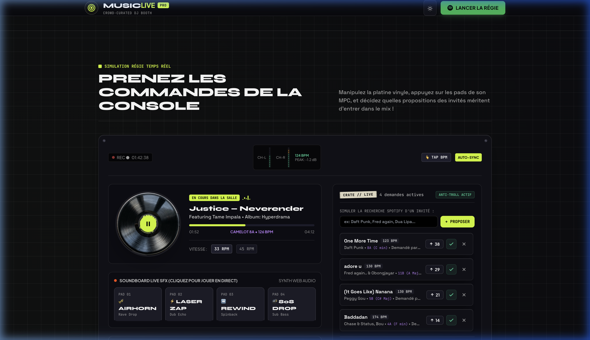
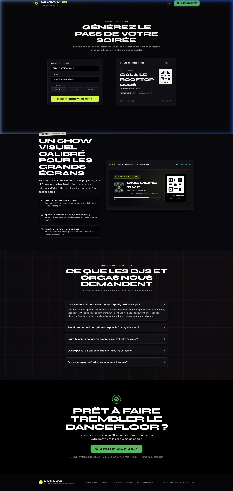
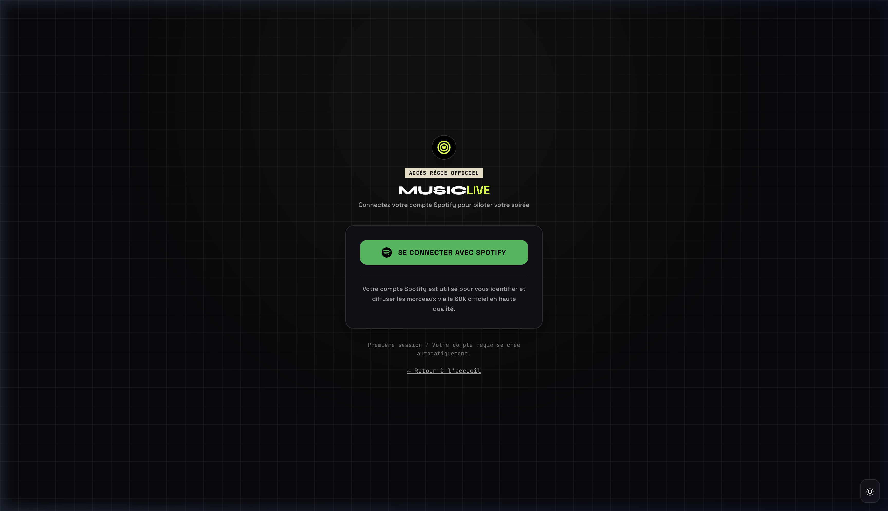

# 🎵 Music Live — Studio DJ Professionnel & Expérience Live Interactive

Une plateforme web temps réel ultra-moderne conçue pour les DJs, les organisateurs d'événements et le public en direct. Music Live permet aux participants de scanner un QR Code pour proposer des musiques au DJ, voter en direct, chanter en Karaoké synchronisé et s'affronter lors de Blind-Tests Flash (15s), avec mix harmonique (Roue de Camelot) et projection multi-écrans à 60 FPS.

---

<p align="center">
  
  = 18" />
  
  
  
  
</p>

---

## 📸 Galerie & Visite Guidée de l'Application

### 🎛️ 1. Console Régie DJ & Nouveau Hub Dashboard

L'interface DJ a été entièrement repensée sous la forme d'un studio matériel professionnel avec barre de navigation latérale par onglets, surveillance en temps réel et contrôle de diffusion immédiat.

<p align="center">
  
  <em>Vue d'ensemble du Dashboard : Sidebar latérale, KPIs de session (taux d'acceptation, demandes en cours, morceaux joués), deck de contrôle live et événements actifs.</em>
</p>

<p align="center">
  
  <em>Onglet Soirée en direct : Barre d'action rapide vers la Régie live, le Grand Écran, les profils Bar/Scène, le QR Code de participation et l'égaliseur temps réel.</em>
</p>

<p align="center">
  
  <em>Console Régie DJ Live : Double deck physique (Deck A : Inbox de modération / Deck B : Queue On-Air), mini monitor OLED grand écran et commandes broadcast.</em>
</p>

<p align="center">
  
  <em>Hit-Parade & Tops : Classement des titres les plus plébiscités avec ratios de votes positifs et fréquence des demandes de la foule.</em>
</p>

<p align="center">
  
  <em>Historique complet des événements : Moteur de recherche instantané par mot-clé, date ou lieu avec accès aux archives et métriques détaillées.</em>
</p>

---

### 🎚️ 2. Nouvelle Page d'Accueil Interactive (Expérience Platine & Synthétiseur)

Fini les pages d'accueil génériques : la nouvelle vitrine plonge l'utilisateur dans une ambiance de régie audio analogique avec platine vinyle tactile, soundboard matériel propulsé par la Web Audio API et générateur de pass en direct.

<p align="center">
  
  <em>Platine Vinyle interactive : Sélecteur de vitesse 33/45 RPM, tonalité harmonique Camelot (8A / C Minor), compteur BPM dynamique et lecture d'ambiance.</em>
</p>

<p align="center">
  
  <em>Soundboard matériel intégré : Génération d'ondes de synthétiseur sans latence (Airhorn, Laser Synth, Rewind FX, Sub 808 Drop) avec oscilloscope actif.</em>
</p>

<p align="center">
  
  <em>Générateur de pass VIP interactif : Personnalisation du nom de l'invité, sélection de la soirée et génération instantanée du ticket néon avec QR d'accès.</em>
</p>

---

### 🔐 3. Rack d'Authentification DJ & Spotify Connect

<p align="center">
  
  <em>Interface de connexion DJ façon rack 19" : Connexion sécurisée avec intégration Spotify Connect, voyants LED de statut et session protégée.</em>
</p>

---

## ✨ Fonctionnalités Clés

### 🎧 Pour la Régie & les DJs

- 🎛️ **Dashboard Studio avec Sidebar Latérale** : Navigation sans rechargement entre Vue d'ensemble, Soirée en direct, Historique filtrable et Hit-parade.
- ✨ **Suggestions Harmoniques (Roue de Camelot & BPM)** : Calcul mathématique automatique des compatibilités tonales (`Mix Parfait`, `Relatif`, `Voisins`, `Energy Boost`) pour des transitions parfaites sans fausse note.
- ⚡ **Mini Blind-Test Flash Régie (15s)** : Déclenchement en 1 clic d'un quiz interactif entre deux morceaux avec 3 leurres cohérents générés automatiquement et podium des gagnants au centième de seconde.
- ↩️ **Annulation de Refus Immédiate (Undo)** : Barre flottante permettant d'annuler un refus accidentel et de réintégrer la demande dans la file.
- ⚡ **Actions en Masse** : Tout accepter ou tout refuser les demandes en attente en un seul geste.
- 🔁 **Anti-Répétition Intelligent** : Délai de temporisation configurable (`repeat_cooldown_minutes`) empêchant de reproposer un titre déjà diffusé récemment.
- 🛡️ **Moteur Anti-Abus & Karma Invité** : Détection dynamique du spam, limitation progressive du quota par invité sans bloquer les participants bienveillants.
- 🎤 **Indicateur Paroles Synchronisées (LRCLIB)** : Repérage instantané des titres compatibles karaoké via le badge micro violet.
- 🎙️ **Alerte Demande de Chant au Micro** : Notification visuelle lorsqu'un invité souhaite monter sur scène chanter le morceau.
- 🎮 **Télécommande Écran Grand Format** : Changement à distance des modes de visualiseur audio et bascule du mode karaoké (raccourcis <kbd>K</kbd>, <kbd>V</kbd>).
- 📊 **Statistiques Live & Export CSV** : Heatmap horaire d'affluence, top artistes, taux de skip et export des données pour analyse post-soirée.

---

### 👥 Pour le Public & les Invités

- 📱 **Zéro Application à Installer** : Scan immédiat du QR Code pour accéder à l'interface de la soirée sans création de compte.
- 🔍 **Moteur de Recherche Spotify Ultra-Rapide** : Recherche instantanée avec pochettes d'albums, artistes et écoute d'extraits audio (previews 30s).
- 📊 **Système de Votes Collaboratif** : Vote pour ou contre les propositions de la salle avec recalcul temps réel des positions.
- 🎤 **Option « Je veux chanter au micro ! »** : Case à cocher dédiée pour avertir le DJ de préparer un micro lors de la diffusion.
- ⚡ **Quiz Blind-Test Flash Tactile** : Écran de jeu synchronisé à 15 secondes avec boutons tactiles colorés, vibration et score live.
- 📲 **Support PWA (Progressive Web App)** : Manifest dynamique (`/manifest-user.json?e=…`) et service worker pour ajouter l'événement sur l'écran d'accueil du smartphone.
- 📜 **Historique Personnel de Soirée** : Suivi des morceaux soumis et consultation de l'avancement dans la file d'attente.
- 🎯 **Compte à Rebours Prédictif** : Estimation du délai avant passage sur la base de la durée des morceaux précédents.

---

### 🖥️ Pour la Projection & le Grand Écran (`/screen/bar`, `/screen/stage`, `/qr`)

- 🌌 **Visualiseur Audio Canvas 60 FPS** : Modes graphiques animés (Spectre Cyber, Halo Néon, Nébuleuse 3D, Barres Dynamiques) réactifs au micro d'ambiance ou à l'entrée ligne via la Web Audio API.
- ⏱️ **Décompte d'Intro Karaoké (3... 2... 1... CHANTEZ !)** : Anneau radial SVG dégressif calé sur le premier timestamp de parole pour que le chanteur ne rate jamais le début du couplet.
- 🎤 **Paroles Synchronisées Grand Format** : Défilement cinétique fluide amorti (`cubic-bezier`) sans saccades avec surlignage lumineux de la strophe en cours.
- 🔥 **Jauge d'Énergie Live (Hype Meter)** : Accumulateur de réactions de la salle déclenchant une pluie de feux d'artifice à 150 particules dorées à 100% (« Ambiance en Fusion ! »).
- 🖥️ **Profils Multi-Display Dédiés** :
  - **`/screen/bar`** : Affichage optimisé pour le bar avec QR Code agrandi (300px) et mise en avant de la file d'attente pour inciter aux commandes.
  - **`/screen/stage`** : Affichage immersif pour écran de scène et vidéoprojecteur avec visualiseur haute saturation et paroles karaoké plein écran.
- 🔒 **Screen Wake Lock API** : Empêche la mise en veille ou l'économiseur d'écran de s'activer sur les téléviseurs et projecteurs.

---

## 🛠️ Stack Technique

### Backend & Temps Réel
- **Node.js (>= 18.0.0)** & **Express.js** : Serveur HTTP performant, compression gzip et architecture modulaire.
- **Socket.IO 4** : Échanges bidirectionnels ultra-faible latence (queue, votes, pilotage d'écrans, blind-test).
- **MySQL 8.0** : Base de données relationnelle optimisée avec index composites pour supporter les pics d'affluence.
- **Redis 6+** : Gestionnaire de sessions distribué pour les environnements de production.

### Audio & Frontend
- **Web Audio API** : Synthétiseur de sons direct, analyseurs FFT et détection des transitoires.
- **Spotify Web API & Playback SDK** : Recherche de métadonnées, tonalité musicale, tempo BPM et lecture audio.
- **LRCLIB API** : Base de données de paroles synchronisées mot-à-mot / ligne-à-ligne.
- **Canvas 2D / 60 FPS** : Moteur de rendu graphique hardware sans dépendance externe lourde.

### Sécurité & Robustesse
- **Bcrypt (12 rounds)** : Hachage fort des mots de passe régie.
- **Helmet** : En-têtes HTTP sécurisés et Content Security Policy (CSP) stricte.
- **Double-Submit CSRF Token** : Protection contre les requêtes falsifiées intersites.
- **Express Rate Limit Multi-Paliers** : Protections distinctes pour l'API générale, l'authentification et les soumissions d'invités.
- **Sanitize HTML & Express-Validator** : Assainissement systématique contre les attaques XSS.

---

## 📋 Prérequis

- **Node.js** >= 18.0.0 (recommandé : Node 20 LTS)
- **MySQL** >= 8.0 (ou MariaDB >= 10.5)
- **Redis** >= 6.0 (optionnel en développement local, recommandé en production)
- **Compte Spotify Developer** (gratuit, pour obtenir les identifiants d'API)

---

## 🚀 Installation & Démarrage Rapide

### 1. Cloner le dépôt

```bash
git clone https://github.com/Fullann/music-live.git
cd music-live
```

### 2. Installer les dépendances

```bash
npm install
```

### 3. Créer la base de données MySQL

Connectez-vous à votre serveur MySQL et exécutez le script d'initialisation :

```sql
CREATE DATABASE music_live CHARACTER SET utf8mb4 COLLATE utf8mb4_unicode_ci;
CREATE USER 'djuser'@'localhost' IDENTIFIED BY 'VotreMotDePasseSecurise';
GRANT ALL PRIVILEGES ON music_live.* TO 'djuser'@'localhost';
FLUSH PRIVILEGES;
```

Puis importez le schéma initial et les migrations d'optimisation :

```bash
# Importer le schéma de base
mysql -u djuser -p music_live < db/db.sql

# Appliquer les index composites et optimisations
mysql -u djuser -p music_live < db/migration_optimizations.sql
```

### 4. Obtenir les identifiants Spotify API

1. Rendez-vous sur le [Spotify Developer Dashboard](https://developer.spotify.com/dashboard).
2. Créez une nouvelle application (ex: `Music Live Console`).
3. Dans les paramètres de l'application, ajoutez l'URL de redirection :
   `http://localhost:3000/callback` (ou votre domaine en production).
4. Récupérez le **Client ID** et le **Client Secret**.

### 5. Configurer l'environnement (`.env`)

Copiez le fichier d'exemple et renseignez vos informations :

```bash
cp .env.example .env
```

Exemple de configuration type :

```env
# Serveur
PORT=3000
NODE_ENV=development
BASE_URL=http://localhost:3000

# Clés Spotify Developer
SPOTIFY_CLIENT_ID=votre_spotify_client_id
SPOTIFY_CLIENT_SECRET=votre_spotify_client_secret
SPOTIFY_REDIRECT_URI=http://localhost:3000/callback

# Base de données MySQL
DB_HOST=127.0.0.1
DB_PORT=3306
DB_USER=djuser
DB_PASSWORD=VotreMotDePasseSecurise
DB_NAME=music_live

# Sessions & Chiffrement
SESSION_SECRET=un_secret_tres_long_et_aleatoire_de_minimum_32_caracteres

# Redis (Optionnel en dev, recommandé en prod)
REDIS_HOST=127.0.0.1
REDIS_PORT=6379
REDIS_PASSWORD=

# Règles de Modération & Rate Limiting
RATE_LIMIT_MAX_REQUESTS=3
RATE_LIMIT_WINDOW_MINUTES=15
```

### 6. Lancer le serveur

```bash
# Mode développement (avec rechargement automatique nodemon)
npm run dev

# Mode production
npm start
```

L'application est immédiatement accessible sur `http://localhost:3000` !

---

## 🗂️ Structure du Projet

```
music-live/
├── db/                             # Schémas et migrations de base de données
│   ├── db.sql                      # Schéma initial (tables djs, events, songs, votes...)
│   └── migration_optimizations.sql # Index haute concurrence et colonnes avancées
├── docs/                           # Documentation et médias
│   └── screenshots/                # Captures d'écran HD de l'application
├── scripts/                        # Scripts de validation CI et maintenance
│   ├── ci-syntax-check.js          # Vérificateur de syntaxe Node sans exécution
│   └── check-database-schema.js    # Contrôle de cohérence de schéma SQL
├── src/
│   ├── config/                     # Configuration DB, Redis, Sessions, Spotify
│   ├── controllers/                # Contrôleurs API (Auth, Événements, DJ, Spotify)
│   ├── middlewares/                # Sécurité (Helmet, CSRF, Auth, Rate-Limiters)
│   ├── public/                     # Ressources statiques front-end
│   │   ├── css/                    # Feuilles de style modernes (hub dashboard, home...)
│   │   ├── js/                     # Scripts clients (dashboard, audio, visualiseur...)
│   │   └── sw-user.js              # Service Worker PWA pour invités
│   ├── routes/                     # Définition des routes Express
│   ├── services/                   # Moteur métier (Queue, Camelot, AbuseService, LRCLIB)
│   ├── sockets/                    # Gestionnaires d'événements Socket.IO temps réel
│   ├── validators/                 # Schémas de validation des requêtes (express-validator)
│   ├── views/                      # Vues HTML (dashboard, home, qr-display, user, login...)
│   └── server.js                   # Point d'entrée de l'application
├── tests/                          # Suite de tests unitaires et d'intégration
│   └── unit/                       # 69 tests automatisés via node:test
├── .env.example                    # Fichier modèle des variables d'environnement
├── package.json                    # Dépendances et scripts NPM
└── README.md                       # Documentation du projet
```

---

## 🔌 API & Événements Temps Réel

### Points d'Entrée API REST Principaux

| Méthode | Route | Description | Accès |
|---|---|---|---|
| `GET` | `/health` | Sonde de santé système (Uptime, MySQL, Redis) | Public |
| `POST` | `/api/auth/register` | Inscription d'un nouveau compte DJ | Public |
| `POST` | `/api/auth/login` | Connexion classique DJ | Public |
| `GET` | `/api/auth/spotify/login` | Démarrage du flux OAuth Spotify Connect | Authentifié |
| `GET` | `/api/auth/me` | Profil et statistiques du DJ connecté | Authentifié |
| `GET` | `/api/dj/dashboard` | Données du hub DJ (événements actifs, KPIs) | DJ |
| `GET` | `/api/dj/history` | Archives et métriques des soirées passées | DJ |
| `POST` | `/api/events` | Création d'une nouvelle soirée | DJ |
| `GET` | `/api/events/:eventId` | Informations de soirée et file d'attente | Public |
| `PATCH` | `/api/events/:eventId/settings` | Modification des paramètres (cooldown, votes...) | DJ Propriétaire |
| `GET` | `/api/events/:eventId/qrcode` | Génération du QR Code SVG personnalisé | Public |
| `GET` | `/api/events/:eventId/live-stats` | Statistiques live (heatmap, skips, tops) | DJ Propriétaire |
| `GET` | `/api/events/:eventId/live-stats.csv`| Export CSV des métriques de la soirée | DJ Propriétaire |
| `GET` | `/api/spotify/search` | Recherche de morceaux dans le catalogue Spotify | Public |

---

### Événements WebSocket Bidirectionnels

#### Émis par le Client vers le Serveur

```javascript
socket.emit('join-event', { eventId, clientId });          // Rejoindre la room de la soirée
socket.emit('request-song', { eventId, track, isKaraoke }); // Soumettre un titre (avec option chant)
socket.emit('vote', { eventId, songId, direction });       // Voter pour (+1) ou contre (-1) un morceau
socket.emit('accept-request', { eventId, songId });        // (DJ) Valider un morceau pour la playlist
socket.emit('reject-request', { eventId, songId });        // (DJ) Refuser une proposition
socket.emit('undo-reject-request', { eventId, songId });   // (DJ) Annuler le refus d'un titre
socket.emit('accept-all-pending', { eventId });            // (DJ) Tout accepter en un clic
socket.emit('reject-all-pending', { eventId });            // (DJ) Tout refuser en un clic
socket.emit('reorder-queue', { eventId, songIds });        // (DJ) Réorganiser l'ordre de passage
socket.emit('mark-played', { eventId, songId });           // (DJ) Marquer comme diffusé
socket.emit('set-screen-visualizer', { eventId, mode });   // (DJ) Changer l'effet visuel du grand écran
socket.emit('set-karaoke-mode', { eventId, enabled });     // (DJ) Basculer l'affichage des paroles
socket.emit('start-blind-test', { eventId });              // (DJ) Déclencher un Blind-Test Flash (15s)
socket.emit('submit-blind-test-answer', { eventId, opt }); // (Invité) Envoyer une réponse au quiz
```

#### Diffusés par le Serveur aux Clients

```javascript
socket.on('queue-updated', (data) => {});           // File d'attente synchronisée en temps réel
socket.on('new-request', (request) => {});          // Nouvelle proposition reçue
socket.on('reject-undone', (data) => {});           // Refus annulé, morceau réintégré dans la file
socket.on('vote-updated', (data) => {});            // Score et votes actualisés
socket.on('screen-visualizer-updated', (d) => {});  // Nouvel effet d'animation grand écran actif
socket.on('karaoke-mode-updated', (d) => {});       // Activation / désactivation du mode Karaoké
socket.on('blind-test-started', (quiz) => {});      // Début du compte à rebours 15s du Blind-Test
socket.on('blind-test-results', (podium) => {});    // Révélation du titre et classement des gagnants
socket.on('request-error', (err) => {});            // Notification d'erreur (cooldown, abus, quotas)
```

---

## 🧪 Tests & Assurance Qualité

Le projet intègre une suite de **69 tests unitaires automatisés** utilisant le runner natif Node.js (`node:test`) pour une exécution ultra-rapide sans surcoût de transpilation.

```bash
# Exécuter l'ensemble de la suite de tests
npm test

# Vérifier la syntaxe de l'ensemble des fichiers du projet
npm run ci:syntax

# Lancer le pipeline CI complet (syntaxe + tests unitaires)
npm run ci
```

### Principaux modules couverts par les tests :
- ✅ **Harmonie Musicale Camelot** : Calcul des clés compatibles, shifts énergétiques et sauts de demi-ton.
- ✅ **Moteur Anti-Abus & Pénalités** : Détection de spam, temporisation progressive et recalcul de karma.
- ✅ **Batching des Votes Haute Concurrence** : Agrégation en mémoire et persistance sécurisée en base.
- ✅ **Décompte d'Intro Karaoké (3-2-1 Chantez !)** : Synchronisation millimétrée avec l'API LRCLIB.
- ✅ **Moteur de Blind-Test Flash** : Génération des leurres plausibles et départage au centième de seconde.
- ✅ **Résolution Multi-Écrans** : Distribution des profils d'affichage (`/screen/bar` vs `/screen/stage`).
- ✅ **Génération SVG des QR Codes** : Rendu vectoriel personnalisé avec intégration de logo.

---

## 🚢 Déploiement en Production

### 1. Process Manager PM2 (Recommandé)

```bash
# Installer PM2 globalement
npm install -g pm2

# Démarrer l'application sous PM2
NODE_ENV=production pm2 start src/server.js --name "music-live" -i max

# Configurer le redémarrage automatique au boot du serveur
pm2 startup
pm2 save
```

### 2. Déploiement Continu Automatique (GitHub Actions + FTPS)

Un workflow GitHub Actions préconfiguré est disponible dans `.github/workflows/deploy-o2switch.yml`. Il valide la syntaxe et les tests unitaires avant de déployer automatiquement chaque commit de la branche `main` vers votre hébergeur (ex: o2switch, cPanel ou serveur dédié).

Configurez simplement vos secrets dans **Settings > Secrets and variables > Actions** :
- `SFTP_HOST` : Adresse IP ou nom de domaine de votre serveur.
- `SFTP_USER` : Nom d'utilisateur FTP/SFTP.
- `SFTP_PASSWORD` : Mot de passe sécurisé.
- `SFTP_TARGET_DIR` : Dossier racine de votre application (ex: `/public_html/` ou `/nodeapps/music-live/`).

---

## 🤝 Contribution

Les contributions et retours d'expérience sont les bienvenus !

1. **Forkez** le projet.
2. Créez une branche dédiée à votre fonctionnalité (`git checkout -b feature/nouvelle-fonctionnalite`).
3. Validez que tous les tests passent : `npm run ci`.
4. Commitez vos modifications (`git commit -m 'feat: ajout nouvelle fonctionnalité'`).
5. Poussez votre branche (`git push origin feature/nouvelle-fonctionnalite`).
6. Ouvrez une **Pull Request** détaillée.

---

## 📝 Licence

Ce projet est distribué sous licence **MIT**. Consultez le fichier [LICENSE](LICENSE) pour plus d'informations.

---

<p align="center">
  Développé avec passion pour faire vibrer les soirées et animer les dancefloors ! 🎛️⚡<br />
  <strong>Si vous appréciez ce projet, pensez à lui laisser une ⭐ sur GitHub !</strong>
</p>